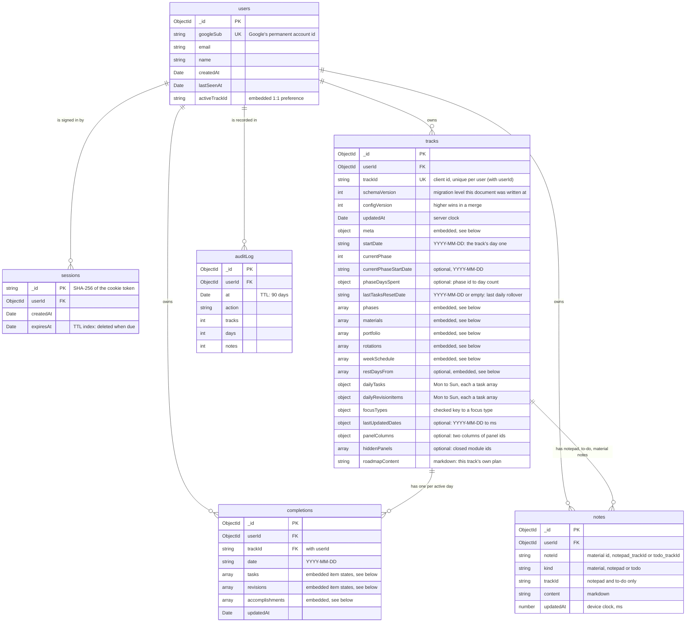

# The data model

Horizon keeps each user's tracks, daily progress and notes in MongoDB, a document database. This is
the model, and why it's shaped the way it is.

Every design choice below starts from how the data is **used**: the app reads and writes a user's data
one track at a time; a sync touches the days that changed; the statistics read one user's days in date
order; search looks inside one user's tracks and notes.

## Contents

1. [Collections at a glance](#1-collections-at-a-glance)
2. [Diagram](#2-diagram)
3. [The collections in detail](#3-the-collections-in-detail)
4. [Design decisions](#4-design-decisions)
5. [Indexes](#5-indexes)
6. [Validation](#6-validation)
7. [Consistency](#7-consistency)
8. [Schema evolution](#8-schema-evolution)
9. [Scaling: replication and sharding](#9-scaling-replication-and-sharding)
10. [Why a document database](#10-why-a-document-database)

## 1. Collections at a glance

| Collection | One document per | Written | Read | Average size* |
|---|---|---|---|---|
| `users` | Google account | sign-in | every request (via the session) | 173 B |
| `sessions` | signed-in browser | sign-in, sign-out | every request | ~150 B |
| `tracks` | track | sync, when its configuration changed | sync, search, stats (names) | 4.2 KB |
| `completions` | track **and day** | sync, when that day changed | sync, stats | 423 B |
| `notes` | note | sync, when that note changed | sync, search | 631 B |
| `auditLog` | sync that changed something | sync | (operations) | ~120 B |
| `rateLimits` | client per minute | every limited request | every limited request | ~80 B |
| `securityEvents` | kind of rejection per hour | whenever the server refuses something | the daily check | ~120 B |

\* From the generated dataset: 2,000 users, 572,152 day documents. See [DATA.md](DATA.md).

## 2. Diagram

`PK` primary key, `FK` a reference to another collection, `UK` unique. Arrays marked *embedded* live
inside their parent document.



### The embedded shapes

Everything marked *embedded* above lives inside its parent document. `?` marks an optional field.

| In | Field | Shape |
|---|---|---|
| `tracks` | `meta` | `id: string`, `name: string`, `color: string`, `templateId: string`, `createdAt: number` (ms), `archived?: bool`, `order?: number` |
| `tracks` | `phases[]` | `id: int`, `title: string`, `description: string`, `tasks: task[]`, `detailedInfo: object`, `recommendedByDay?: int` |
| `tracks` | `materials[]` | `id: string`, `title: string`, `author?: string`, `category: string`, `type: string`, `status: string`, `currentPage: int`, `totalPages: int`, `currentSubject: string`, `link: string`, `localPath?: string`, `repoUrl?: string`, `archived?: bool`, `updatedAt?: number` (ms) |
| `tracks` | `portfolio[]` | `id: string`, `title: string`, `completed: bool`, `localPath?: string`, `repoUrl?: string` |
| `tracks` | `rotations[]` | `id: string`, `label: string`, `items: {title, description?}[]`, `daysOfWeek: string[]`, `target: "revision" \| "focus"`, `startWeek: int`, `phase?: int`, `explanation?: string` |
| `tracks` | `weekSchedule[]` | `name: string` (`Mon`..`Sun`), `type: string` (a `focusTypes` key), `label: string` |
| `tracks` | `restDaysFrom[]` | `date: string` (`YYYY-MM-DD`), `days: string[]` — the weekdays off *from* that date |
| `tracks` | a task | `id: string`, `title: string`, `completed: bool`, `description?: string` |
| `tracks` | a focus type | `label: string`, `color: string`, `restDay?: bool` |
| `completions` | `tasks[]`, `revisions[]` | `id: string`, `done: bool`, `updatedAt: number` (ms) |
| `completions` | `accomplishments[]` | `title: string`, `description?: string`, `plain?: bool`, `done: bool`, `updatedAt: number` (ms) |

Two collections stand apart from the diagram, because they belong to no user by design:

- `rateLimits`: `{ _id: "bucket:sha256(client):windowStart", count, expiresAt }`, deleted by a TTL index
  two minutes later.
- `securityEvents`: `{ _id: "sign-in-rejected:2026-09-22T14", kind, hour, count, firstAt, lastAt,
  expiresAt }`, deleted after 30 days. One document per kind of rejection per hour — a rejected sign-in,
  a client past its rate limit, a body that fails validation, a write the database refuses — raised with
  an atomic `$inc`. The daily operations check reads them (`npm run ops:check`); no address, account or
  value is stored, so they say what is happening without saying to whom.

## 3. The collections in detail

### `tracks`: one document per track, configuration embedded

A real document from the generated dataset (long arrays shortened):

```json
{
  "_id": "6aa2f7aa2fea176ce9912329",
  "userId": "97da2849d73eb438a907d090",
  "trackId": "track_0_0",
  "schemaVersion": 3,
  "configVersion": 27,
  "updatedAt": "2026-09-01T12:00:00.000Z",
  "meta": { "id": "track_0_0", "name": "Learning 1", "color": "#a78bfa", "templateId": "learning", "createdAt": 1756771200000 },
  "startDate": "2025-09-02",
  "phases": [
    { "id": 1, "title": "Phase 1: Fundamentals", "description": "Learn the core vocabulary and basic mechanics.",
      "recommendedByDay": 45, "tasks": [{ "id": "p1_t1", "title": "Pick your primary learning resource", "completed": false }] }
  ],
  "materials": [
    { "id": "m_0_0_0", "title": "Physically Based Rendering", "author": "Pharr", "status": "done", "currentPage": 270, "totalPages": 350 }
  ],
  "weekSchedule": [{ "name": "Mon", "type": "study", "label": "Study" }],
  "focusTypes": { "study": { "label": "Study", "color": "#a78bfa" } },
  "dailyTasks": { "Mon": ["…"], "Sun": ["…"] },
  "roadmapContent": "…"
}
```

### `completions`: one document per track per day (the bucket pattern)

```json
{
  "_id": "6aa2f79a2fea176ce9885731",
  "userId": "97da2849d73eb438a907d090",
  "trackId": "track_0_0",
  "date": "2026-04-27",
  "tasks":     [{ "id": "t_1_0", "done": true, "updatedAt": 1777305600000 }, { "id": "t_1_1", "done": true, "updatedAt": 1777305600000 }],
  "revisions": [{ "id": "r_1_0", "done": true, "updatedAt": 1777305600000 }],
  "accomplishments": [
    { "title": "Physically Based Rendering", "done": true, "updatedAt": 1777305600000 },
    { "title": "Designing Data-Intensive Applications", "done": true, "updatedAt": 1777305600000 }
  ],
  "updatedAt": "2026-09-01T12:00:00.000Z"
}
```

`done: false` with a timestamp means "unticked at that time"; the merge needs that to tell "unticked"
from "never ticked". `updatedAt: 0` marks ticks from before per-item timestamps existed.

The app itself holds a track as one nested object (`TrackState` in `lib/types.ts`). The server converts
between the two with `splitWorkspace` / `assembleWorkspace` in `lib/server/sync/model.ts`, and a test
proves the real data survives the round trip.

## 4. Design decisions

**Embed a track's configuration.** Phases, materials, rotations and the schedule are small (dozens of
items), belong to exactly one track, are always read and written together with it, and are merged per
item by the sync. Separate collections would mean several reads for every track and cross-collection
writes for every edit, for nothing in return.

**Split progress into one document per day (bucket pattern).** History grows forever: a document can't
exceed 16 MB, and a heavy user's years of days would eventually approach it. Worse, ticking one box would
rewrite the whole track (write amplification). One document per day keeps every write small, lets a sync
write only the days that changed, and gives the statistics an index to walk in date order. A bucket per
*day* rather than per week or month matches what changes together: a day's ticks.

**Count rejections, don't list them.** `securityEvents` uses the same bucket idea for a different
reason. A document per rejected sign-in would be a denial-of-service vector: anyone could fill the
database by failing on purpose. One document per kind per hour costs the same whether something happens
twice or two million times, and `$inc` makes concurrent writes safe without a read first. It is the
clearest case in this project of the *access pattern*, not the data, deciding the shape.

**Not one document per user.** It's the simplest mapping of the app's `Workspace`, and wrong for the same
reasons, times every track.

**User input never becomes a field name.** On the device, a day's accomplishments are a map keyed by
*title*. A title like `Read ch. 3` contains a `.`, which MongoDB reads as a path; `$where` would look like
an operator. The server stores them as arrays of values (`{ title, done, updatedAt }`). The only keys that
become field names are fixed ones (weekday names) or strictly checked ones (focus-type keys,
`[A-Za-z0-9_-]`).

**Embed 1:1 facts in their owner.** The user's last active track lives in the `users` document rather than
a collection of its own.

**Reference across ownership.** Days refer to their track by `trackId`, and everything refers to its
user by `userId`. Track ids are generated on devices and are only unique *per user* (every migrated old
workspace has the same one), so every lookup uses both, including the `$lookup` in the statistics.

**Store what's needed, derive the rest.** `streakHistory` isn't stored: it's the days with an
accomplishment, and the app rebuilds it from those on every change anyway.

**Keep devices' clocks with devices' clocks.** A note's `updatedAt` is the device's millisecond timestamp,
compared only with other devices' timestamps (last write wins), never with the server's clock.
Timestamps from the future are clamped to the present on the way in.

## 5. Indexes

| Collection | Index | Serves |
|---|---|---|
| `users` | `{ googleSub: 1 }` unique | finding the account at sign-in; one account per Google identity |
| `sessions` | `{ _id }` (the hash), `{ userId: 1 }`, `{ expiresAt: 1 }` TTL | session lookup; deleting expired sessions automatically |
| `tracks` | `{ userId: 1, trackId: 1 }` unique | a sync's reads and writes; one document per track |
| `tracks` | `{ userId: 1, <text fields> }` text, weighted | search, only ever within one user |
| `completions` | `{ userId: 1, trackId: 1, date: 1 }` unique | sync (by the `userId` prefix), date ranges, every statistics pipeline |
| `notes` | `{ userId: 1, noteId: 1 }` unique, and `{ userId: 1, content: "text" }` | sync; search |
| `auditLog` | `{ at: 1 }` TTL 90 days | deleting old entries |
| `rateLimits` | `{ expiresAt: 1 }` TTL | deleting old counters |
| `securityEvents` | `{ expiresAt: 1 }` TTL 30 days, and `{ kind: 1, hour: -1 }` | deleting old counters; the daily check reading one kind's recent hours |

- **Compound indexes and prefixes.** `{userId, trackId, date}` also serves any query on `{userId}` or
  `{userId, trackId}`, so no separate single-field indexes are needed.
- **The ESR rule.** Equality first, then sort, then range. `userId` and `trackId` are matched exactly,
  and `date` is a range. [PERFORMANCE.md](PERFORMANCE.md) measures the difference against a
  `{date, …}`-first index.
- **Text indexes.** A collection can have only one, and it costs space: on the generated data the tracks'
  text index is about three times the size of the tracks themselves on disk. The `userId` prefix makes
  every search a one-user search.
- **TTL indexes.** They replace cron jobs: MongoDB deletes expired sessions, old audit entries, old rate
  counters and old security counters itself (a background task, about once a minute). Each collection's
  retention is one number in its index: 30 days for sessions, 90 for the audit log, 30 for security
  counters, two windows for rate limits.

## 6. Validation

Two layers:

1. **zod, on every request** (`lib/server/sync/schema.ts`). Strict: an unexpected field is refused, and
   so is a wrong type, an operator where a value belongs, or an oversized string or array.
2. **`$jsonSchema` validators, in the database** (`lib/server/collections.ts`). They check the shape the
   server writes: required fields, types, patterns (`date` must be `YYYY-MM-DD`), and no extra fields in a
   day's items. If a bug let something malformed through, MongoDB refuses it (error 121).

Mongoose adds casting for the models it manages (users, sessions, notes), and `sanitizeFilter`, which
neutralises operators smuggled into queries.

## 7. Consistency

A sync is **one multi-document transaction** (snapshot reads, `writeConcern: majority`): read the
user's documents, merge the device's changes in, write back only what changed, add an audit entry. Either
all of it commits or none does.

Two devices syncing at once can't overwrite each other. If both write the same document, MongoDB detects
the write conflict, fails one commit, and the driver runs that transaction again on the newer data.
Within a document, the merge is last-write-wins *per item* (each tick box, each accomplishment, each
material has its own timestamp), so the retried merge keeps both devices' changes.

Without foreign keys, cross-collection rules are the application's job, and the transaction is what makes
that safe. Deleting an account is the clearest case: MongoDB won't cascade the delete, so
`lib/server/account/handlers.ts` removes the user's documents from every collection that holds a `userId`,
and then the user, in one transaction. Either everything goes, or nothing does.

## 8. Schema evolution

The app's data shape has changed over time: single track to many, new fields, renamed ones. MongoDB
doesn't force a migration of every document when that happens. Horizon uses the **schema versioning
pattern**: every track document records the `schemaVersion` it was written at, and the app's migration
pipeline (`lib/migrations`, an append-only list of idempotent steps) upgrades older shapes as they're
read. Documents are brought to the new shape the next time they're written, so old and new shapes can
coexist safely in the meantime.

## 9. Scaling: replication and sharding

**Replication** (built): three members, one primary. See [RESILIENCE.md](RESILIENCE.md) for the failover
measurements, and write concern, read concern and read preference.

**Sharding** (designed, not deployed). Sharding splits a collection across several replica sets
(shards) by a *shard key*.
- **Shard key: `{ userId: "hashed" }`** for `tracks`, `completions` and `notes`. Every query the app
  makes includes `userId`, so each one goes to exactly one shard (a *targeted* query, not a scatter to
  all shards). Hashing spreads users evenly, and one user's data stays together.
- **Why not the date or `_id`?** Both increase over time. Every new write would land on the same "last"
  shard (a *hot shard*), and one user's queries would scatter across all of them.
- **Why not `trackId`?** It isn't unique across users, and its client-generated values are uneven.
- `users` and `sessions` are small: unsharded, or hashed on `_id`.
- On Atlas's free tier, sharding isn't available; it's a paid-tier feature. The design is ready for it,
  because no query depends on data from two users.

**Volume.** A year of a heavy user is about 1,000 day documents and 400 KB. The generated dataset
(2,000 users) is 251 MB of data, 48 MB on disk after compression. Per-user queries stay at a few
milliseconds regardless of total size, because every one of them uses an index that starts with the
user ([PERFORMANCE.md](PERFORMANCE.md)).

## 10. Why a document database

**Against relational (e.g. PostgreSQL).** A relational version needs about ten tables: tracks, phases,
phase tasks, materials, a many-to-many between phases and materials, day items, completions and
accomplishments. It would also need a mapper between the app's nested `TrackState` and those rows, and a
migration for every schema change. It would gain foreign keys, cascading deletes, joins and SQL window
functions. For this app, the document model matches the shape the app already uses, and reuses the
existing merge logic unchanged. The cost is that consistency across collections is the application's
responsibility (see §7). The full comparison is in `MODULES_PLAN.md`, Appendix A.

**Against other NoSQL types.**
- **Key-value** (e.g. Redis): excellent for sessions or the rate counters. But it can't query inside a
  value (no search, no statistics by date), so it would push all of that into the app.
- **Wide-column** (e.g. Cassandra): built for huge write volumes spread across many machines, with queries
  designed per table in advance. Horizon's volume is modest, and it needs flexible per-user queries,
  transactions and text search.
- **Graph** (e.g. Neo4j): built for data whose value is in its relationships (social graphs,
  recommendations). Horizon's data is a tree (user → track → days), with no many-to-many web to traverse.
- **Document** fits: tree-shaped data read and written per owner, a flexible schema with validators, rich
  queries, aggregation, text search, transactions, and replication and sharding built in.
