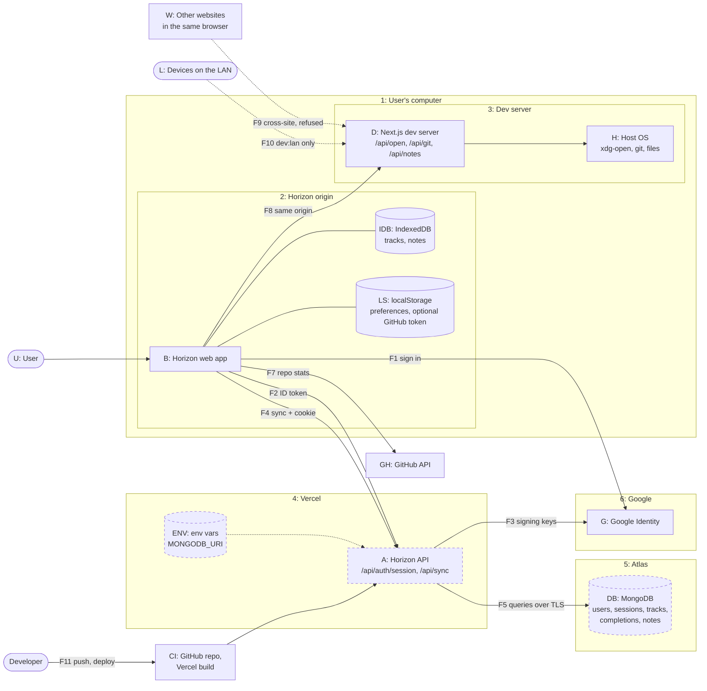

# Horizon threat model

**Version 1.8, 2026-09-10** (1.1 added the local database from 0.17.1; 1.2 marks
sign-in with Google, from 0.18.0, as built, and adds S6; 1.3 updates T8 for the
0.18.1 dependency upgrade; 1.4 marks sync, from 0.19.0, as built;
1.5 adds rate limiting and the local-route fixes from 0.19.1;
1.6 adds the read-only search and stats routes from 0.20.0;
1.7 adds account deletion from 0.21.0 and T10;
1.8 marks the 0.21.1 development life cycle measures). Models Horizon v0.21.1 *and* the planned sign-in
with Google plus MongoDB sync (`MODULES_PLAN.md`, Step 4), so that
security is designed in before the server is built. Parts that don't exist yet
are marked **planned**. Revisit after Step 4 ships, and whenever a route, a
data store or a third party is added.

## Contents

1. [How this was made, and how to read it](#1-how-this-was-made-and-how-to-read-it)
2. [Scope and assumptions](#2-scope-and-assumptions)
3. [The system](#3-the-system)
4. [Assets](#4-assets)
5. [Who might attack](#5-who-might-attack)
6. [Threats](#6-threats)
7. [By layer](#7-by-layer)
8. [By security goal](#8-by-security-goal)
9. [Accepted risks](#9-accepted-risks)
10. [Actions](#10-actions)
11. [Glossary](#11-glossary)

**Highest risks** (rated before mitigation): the API returning another user's
data (I1), accepting a forged or foreign Google token (S1, S2), a stolen
session cookie (S3), NoSQL injection and mass assignment (T1, T2), secrets or
tokens leaking into git or logs (I6, I7), an over-privileged database user
(E5), a compromised dependency (T8), and other websites reaching the local dev
server (E1, fixed in 0.14.4).

---

## 1. How this was made, and how to read it

1. **Draw the system** as a data-flow diagram: who and what takes part, where
   data is stored, and how it moves (§3).
2. **Mark the trust boundaries**: every line where data passes from something
   we control to something we don't, or between different levels of trust.
   Most attacks happen at a boundary.
3. **Walk every element and flow through STRIDE**, a checklist of six kinds of
   threat. Processes are checked for all six; data stores and flows for
   tampering, information disclosure and denial of service; external parties for
   spoofing and repudiation.

   | Letter | Threat | Violates |
   |---|---|---|
   | **S**poofing | Pretending to be someone or something else | Authenticity |
   | **T**ampering | Changing data or code without permission | Integrity |
   | **R**epudiation | Denying an action, with no way to prove it | Non-repudiation |
   | **I**nformation disclosure | Data reaching someone who shouldn't see it | Confidentiality |
   | **D**enial of service | Making the app or its data unavailable | Availability |
   | **E**levation of privilege | Doing more than you're allowed to | Authorization |

4. **Rate each threat** before any mitigation, so the rating shows how much
   the mitigation matters:
   - Likelihood (L): 1 unlikely, 2 possible, 3 likely.
   - Impact (I): 1 minor (an annoyance, or only the attacker's own data);
     2 moderate (one user's data, or the service down for a while);
     3 severe (many users' data, account takeover, or code running on a
     computer).
   - Risk = L × I: 1–2 **Low**, 3–4 **Medium**, 6–9 **High**.
5. **Decide for each threat**, recorded as its status:
   - **Implemented**: done, and where.
   - **Planned**: will be done, and in which plan step.
   - **Accepted**: left as is on purpose, with the reason.
   - **Open**: known, not yet decided.

## 2. Scope and assumptions

**In scope:** the web app in the browser, the planned API on Vercel, MongoDB
(Atlas in production, a Docker replica set locally) and Google sign-in
sync, the GitHub API, the local dev server and the computer it runs on, and
how code gets from the repo to production.

**Out of scope:**
- Malware already running on the user's computer. It can read everything the
  user can, so no web app can defend against it.
- Attacks on Google, Vercel, MongoDB Atlas or GitHub themselves. They are
  trusted third parties.
- Tricking a user into giving away their Google password. Horizon never sees
  that password.

**Assumptions:**
- Offline mode (no account) keeps all data in the browser. The only copy
  outside the device is the account's copy on the server, for anyone signed in.
- Signed-in users sync to MongoDB. Anyone not signed in keeps everything on the device
  sync as today.
- One developer, who also owns every account: GitHub, Vercel, Google Cloud,
  Atlas.

## 3. The system

Dashed boxes are **planned** (Step 4 of the plan); everything else exists
today. The numbered frames are the trust boundaries listed below the tables.

### Elements

| ID | Element | Kind | Status |
|---|---|---|---|
| U | The user | External | |
| B | Horizon web app, running in the browser | Process | Exists |
| IDB | IndexedDB: the workspace (all tracks) and notes | Data store | Exists |
| LS | localStorage: preferences, optional GitHub token | Data store | Exists |
| W | Other websites open in the same browser | External | |
| D | Local dev server: `/api/open`, `/api/git`, `/api/notes` (only on the user's own computer; production refuses them, checked live 2026-09-10) | Process | Exists |
| H | The computer's operating system: `xdg-open`, `git`, files | Process | Exists |
| L | Other devices on the same network | External | |
| A | Horizon API on Vercel: `/api/auth/session`, `/api/sync`, `/api/search`, `/api/stats`, `/api/account` | Process | All exist and run locally (0.18.0–0.21.0); deployed with Atlas in week 5 |
| ENV | Vercel environment variables, and `.env.local` locally: `MONGODB_URI` | Data store | Planned (4a) |
| DB | MongoDB: Atlas in production, a three-member Docker replica set locally | Data store | Local exists (0.17.1); Atlas planned (4a) |
| G | Google Identity: sign-in (OpenID Connect) | External | Exists |
| GH | GitHub API, for repo stats on materials | External | Exists |
| CI | GitHub repo, CI, Vercel build and deploy | Process | Repo and deploy exist; CI planned (Step 6) |

### Data flows

| ID | From → to | What | Status |
|---|---|---|---|
| F1 | B → G → B | Sign in with Google; Google returns a signed ID token | Exists (0.18.0) |
| F2 | B → A | The ID token is posted to `/api/auth/session`; a session cookie comes back | Exists (0.18.0) |
| F3 | A → G | The API fetches Google's public signing keys | Exists (0.18.0) |
| F4 | B ↔ A | `GET` and `PUT /api/sync`, authenticated by the session cookie | Exists (0.19.0) |
| F5 | A ↔ DB | Queries and transactions over TLS | Exists locally (0.19.0); TLS with Atlas |
| F7 | B → GH | Repo stats, with an optional GitHub token | Exists |
| F8 | B → D → H | The app calling its own local routes (same origin) | Exists |
| F9 | W → D | Another website sending a request to the local server | Refused since 0.14.4 |
| F10 | L → D | LAN devices, only while `npm run dev:lan` runs | Exists when used |
| F11 | Developer → CI → A | Push to GitHub, Vercel builds and deploys | Exists |

### Trust boundaries

1. **The user's computer** vs everything else.
2. **Horizon's browser origin** vs other websites in the same browser. The
   browser's same-origin policy is the wall; F9 is an attempt to get over it.
3. **The local dev server** vs the network it's reachable from.
4. **Browser vs API.** The API trusts nothing the browser sends: every body is
   validated and every request is authenticated.
5. **API vs database.** The database is reachable over the internet (I8), so
   the password and TLS are what protect it.
6. **Horizon vs Google and GitHub.** Third parties we depend on but don't
   control.

## 4. Assets

| Asset | Why it matters | Where it lives |
|---|---|---|
| Users' tracks, progress and notes | Personal data; notes can contain anything | IDB, SQLite on a phone, DB, backup files |
| Session cookies | Whoever holds one is signed in as that user | Browser cookie jar; only a hash in DB |
| Google ID tokens | Short-lived proof of who the user is | In transit only (F1, F2) |
| GitHub token (optional) | Whatever access the user granted it | LS |
| Database credentials | Full read and write on the app's database | ENV |
| The deployed code | Runs in every user's browser and on the server | CI |
| The user's computer | The local routes can open files and URLs on it | H |

## 5. Who might attack

| Attacker | Typical attempt | Threats |
|---|---|---|
| Anyone on the internet | Scan the API, flood it, send forged tokens | S1, S2, D1, D2, I8 |
| A website the user visits | Send requests to the local dev server | E1 |
| Another Horizon user, with a real account | Read or change someone else's data | I1, T1, T2 |
| Someone on the same network (café, dorm) | Watch or change traffic; reach the dev server | T5, E2 |
| Someone with physical access to a computer | Read browser data and files | I10 |
| A compromised dependency or account | Ship malicious code | T8, T9 |
| Honest mistakes | Bugs, a wrong clock, a leaked secret | T3, T4, I7 |

Security includes accidents: a missing filter that mixes two users' data is a
data leak whether or not anyone was attacking.

## 6. Threats

L = likelihood, I = impact, both 1–3. Risk is rated before mitigation. Plan
steps like "4b" refer to `MODULES_PLAN.md`.

### Spoofing: pretending to be someone else

| ID | Threat | Where | L | I | Risk | Mitigation | Status |
|---|---|---|---|---|---|---|---|
| S1 | Forged ID token: an attacker builds a token that claims to be a victim's Google account | F2, A | 2 | 3 | High | Verify the token's RS256 signature against Google's published keys, and check `iss`, `exp` and `email_verified`. Identify users by `sub` (Google's permanent ID), never by email | Implemented (0.18.0: `lib/server/auth/googleIdToken.ts`, with `jose`; tested with forged, unsigned and algorithm-confusion tokens, and live against Google's keys) |
| S2 | A real ID token that Google issued to another app, replayed to Horizon | F2, A | 2 | 3 | High | Check that `aud` equals Horizon's client ID | Implemented (0.18.0; tested) |
| S3 | A stolen session cookie used from another browser | F4, A | 2 | 3 | High | The cookie is `HttpOnly` (scripts can't read it), `Secure` (HTTPS only) and `SameSite=Lax`. Sessions expire (TTL index), and signing out deletes the session on the server, so a copied cookie stops working | Implemented (0.18.0: `lib/server/auth/session.ts`, `__Host-` cookie; tested, including that a copied cookie stops working after sign-out) |
| S4 | A guessable or reused session ID | A, DB | 1 | 3 | Medium | A 256-bit random token from `crypto`, new at every sign-in. The database stores only its SHA-256 hash, so a leaked `sessions` collection contains no usable cookies | Implemented (0.18.0; tested that the token appears nowhere in the database) |
| S5 | Another site uses Horizon's client ID to pose as Horizon on Google's sign-in | G | 1 | 2 | Low | Google accepts the client ID only from its listed origins: the localhost ports and `https://horizonroadmap.com` | Implemented (Google Cloud client settings) |
| S6 | A captured ID token replayed to Horizon within its hour, to get a session | F2, A | 1 | 3 | Medium | Tokens travel only over TLS between the browser, Google and Horizon, and are never logged (I6). The realistic way to capture one is XSS in the page (I2), which can already act as the user, so replay adds little. A nonce tied to the browser (issued by the server, echoed in the token) would close it | Accepted; the nonce is an option if the risk changes |

### Tampering: changing data or code without permission

| ID | Threat | Where | L | I | Risk | Mitigation | Status |
|---|---|---|---|---|---|---|---|
| T1 | NoSQL operator injection: a body like `{"trackId": {"$ne": null}}` turns "find this track" into "find any track" | F4, A, DB | 2 | 3 | High | zod schemas, so a field that must be a string can't be an object. Reject keys that start with `$` or contain `.`. Never pass a request body straight into a query filter; turn on Mongoose's `sanitizeFilter` | Implemented (0.18.0 sign-in, 0.19.0 sync: strict zod schemas; keys that become field names limited to `[A-Za-z0-9_-]`; free-text titles stored as values, never field names; Mongoose `sanitizeFilter`; `$jsonSchema` validators on every sync collection, tested) |
| T2 | Mass assignment: the body carries `userId` or `_id` to write into someone else's data | F4, A | 2 | 3 | High | `userId` only ever comes from the session (`requireUser`). The server builds each document from the fields it allows | Implemented (0.19.0: `userId` only from the session; strict schemas refuse a smuggled `userId`, tested) |
| T3 | Timestamps in the future (a wrong device clock, or a crafted body) win every last-write-wins merge forever | F4, A | 2 | 1 | Low | Validation rejects or clamps timestamps later than server time plus a small allowance, and bounds `configVersion` | Implemented (0.19.0: `clampWorkspace` pulls future timestamps back to now + 5 min, tested) |
| T4 | Lost update: two devices sync at the same moment and one silently overwrites the other | F4, A, DB | 2 | 2 | Medium | Merge on the server inside one transaction, with write concern `majority`. Add a version check if the transaction alone doesn't cover it | Implemented (0.19.0: the merge runs in a transaction with snapshot reads and majority commits; a write conflict makes the driver retry with the newer data; tested with two simultaneous syncs) |
| T5 | Traffic between the browser and Vercel changed in transit | F2, F4 | 1 | 3 | Medium | HTTPS only: plain HTTP gets a 308 redirect to HTTPS, and HSTS (`max-age=63072000`, two years) keeps browsers on HTTPS | Implemented (Vercel; checked live 2026-09-10) |
| T6 | Traffic between Vercel and Atlas changed in transit | F5 | 1 | 3 | Medium | Atlas only accepts TLS connections | Planned (4a) |
| T7 | A crafted backup file restored through Settings | B, IDB | 1 | 2 | Low | Its shape is checked before restore (`lib/import.ts`), the user confirms first, and content is shown through the escaping markdown renderer. Gap: note contents aren't checked to be strings | Implemented (0.19.1: every note must be a string under an id of `[A-Za-z0-9_-]`, or the restore is refused; tested) |
| T8 | A compromised npm package runs during the build or in users' browsers | CI, B, A | 2 | 3 | High | Few dependencies (9 at runtime), exact versions pinned in `package-lock.json`. `npm ci` and `npm audit` in CI, and Dependabot alerts. The CSP limits where injected code can send data (but see I3) | Implemented (0.21.1: CI runs `npm audit --audit-level=high` and `npm audit signatures` on every push; Dependabot configured for npm, Actions and the mongo image; Semgrep SAST in CI; actions pinned by SHA and scanner images by digest; a lockfile and `npm ci`; npm blocks install scripts; audit clean since 0.18.1) |
| T9 | Someone who gets into the GitHub or Vercel account pushes malicious code, which deploys automatically | F11, CI | 1 | 3 | Medium | Two-factor authentication on GitHub and Vercel. A ruleset on `main`: pull request and passing CI required, no force pushes | CI on every push (0.21.1): types, lint, tests, build and database tests. A ruleset on `main` requiring it, and 2FA on every account: owner's actions (RUNBOOK §1; the ruleset needs GitHub Pro, active from about 2026-09-13) |
| T10 | A stolen session is used to delete the account and everything it stored on the server | F4, A, DB | 1 | 2 | Low | The session is hard to steal (S3: HttpOnly, Secure, SameSite, server-side revocation), deletion needs a same-origin request, and every device keeps a full copy, so the data can be synced into a new account. Asking for a fresh Google sign-in just before deleting (*step-up authentication*) would close it | Accepted (0.21.0); step-up authentication is the option if the risk changes |

### Repudiation: denying an action, with no way to prove it

| ID | Threat | Where | L | I | Risk | Mitigation | Status |
|---|---|---|---|---|---|---|---|
| R1 | No record of which session changed or deleted data ("I never deleted that track") | A, DB | 2 | 1 | Low | An `auditLog` of sync writes (user, time, action, counts), deleted after about 90 days by a TTL index. Its limit: whoever runs the database could edit it. Proof that holds even against the operator would need digital signatures | Implemented (0.19.0: `auditLog`, one entry per sync that changed something, 90-day TTL). The limit stands: whoever runs the database could edit it. Deleting an account also deletes its audit entries: the right to erasure outweighs the record; the server log keeps only the counts deleted |
| R2 | Failed sign-ins and rate-limit hits go unrecorded, so an attack can't be noticed or reconstructed | A | 2 | 2 | Medium | Log auth failures and rate-limit hits (never tokens) and alert on spikes | Sign-in rejections logged by reason code (0.18.0); the first rate-limit refusal per window logged by bucket, without the address (0.19.1); counted per kind per hour in `securityEvents` and read by a scheduled check that emails on anything out of character (0.22.0). Vercel's free plan has no log drains, so the counters live in the database instead |

### Information disclosure: data reaching someone who shouldn't see it

| ID | Threat | Where | L | I | Risk | Mitigation | Status |
|---|---|---|---|---|---|---|---|
| I1 | IDOR: user A asks for a track by its id and gets user B's. Track ids are only unique per user, and every migrated legacy workspace has the same one (`track_legacy_engine_graphics`), so even a bug without an attacker would mix users' data | F4, A, DB | 3 | 3 | High | Every query filters by the session's `userId`. A unique index on `{userId, trackId}`. Tests that user A can't read or write user B's tracks, completions or notes, even with the same track id | Implemented (0.19.0 sync; 0.20.0 search and stats: every query and every `$lookup` filters by the session's `userId`; compound text indexes start with `userId`; tested with two users sharing `track_legacy_engine_graphics`) |
| I2 | Cross-site scripting (XSS): injected script reads the GitHub token and everything in IndexedDB, or sends requests as the signed-in user | B, LS, IDB | 1 | 3 | Medium | React escapes what it renders. The markdown renderer escapes all HTML and allows only safe link schemes (`lib/markdown.ts`). The session cookie is `HttpOnly`. The CSP limits where data can be sent, within the limits described in I3 | Implemented |
| I3 | The CSP's `connect-src` allowlist doesn't cover every way out. Injected script could still send data inside an image URL (`img-src https:` allows any HTTPS host), or by navigating the page away | B | 1 | 3 | Medium | Narrow `img-src` to `'self' data: blob:`; the app loads no external images today. Add Google's avatar host only if the UI shows one. No CSP rule can restrict navigation, so preventing XSS (I2) remains the real defence | Implemented (0.18.0: `img-src 'self' data: blob:`) |
| T5 | Cross-site request forgery: another site makes the browser act as the signed-in user | A | 2 | 3 | High | `Origin` and `Sec-Fetch-Site` checked on every state-changing route; JSON-only bodies; SameSite cookie | Implemented (0.14.4 for the local routes, 0.19.0 for the account API). Refined 0.28.2: a request carrying **no cookie** is allowed without an `Origin` — it has no ambient authority to abuse, which is what CSRF depends on, and the phone authenticates with a Bearer token it supplies deliberately. A cookie with no `Origin` is still refused |
| I4 | Error messages reveal internals: `/api/git` and `/api/notes` return the raw `error.message`, and `/api/git`'s 403 names the home directory | D | 1 | 1 | Low | Generic messages to the client, details only in server logs. New routes do this from the start | Implemented (0.19.1: `/api/git` and `/api/notes` return generic messages and log details server-side; the 403 no longer names the home directory; tested) |
| I5 | `/api/git` checks whether a path exists *before* applying the `~/Documents` restriction, so a 404 vs a 403 reveals whether any path on the computer exists | D, H | 1 | 1 | Low | Check the path against `~/Documents` first, then whether it exists, then its real path (to catch symlinks) | Implemented (0.19.1: the `~/Documents` check runs on the path as written before any existence check, and again after following symlinks; tested) |
| I6 | Tokens or cookies written to logs | A | 2 | 3 | High | Never log request bodies or headers on the auth and sync routes | Implemented (sign-in 0.18.0, sync 0.19.0: generic errors; logs carry reason codes or error names only) |
| I7 | The database password leaks: committed to git, or pasted somewhere | ENV, CI | 2 | 3 | High | `.env*` files are git-ignored. Secrets live only in Vercel's environment variables and `.env.local`; only `.env.example`, with placeholders, is committed. Scan the git history with gitleaks and rotate anything found | Implemented (`.gitignore`; per-machine secrets in mode-600 files; gitleaks over the whole history found nothing, 149 commits, 2026-09-10, and runs on every push since 0.21.1; rotation steps in RUNBOOK §3). Atlas credentials live only in Vercel, in GitHub Actions secrets and in `.env.local`, all three write-only or git-ignored (0.22.0) |
| I8 | Anyone on the internet can try to connect to the Atlas cluster. The free tier has no private networking and Vercel's outgoing IP addresses change, so the access list has to allow `0.0.0.0/0` | DB | 1 | 3 | Medium | A long random password, TLS, a database user limited to `readWrite` on one database, and separate users for production and preview | Network exposure Accepted; the rest Planned (4a) |
| I9 | A copy of the database leaks: an Atlas breach, or a stray `mongodump` file | DB | 1 | 3 | Medium | Atlas encrypts storage at rest. Sessions are stored only as hashes, and there are no passwords to steal, because Google handles sign-in. Dumps stay out of the repo | Planned (4a, Step 6) |
| I10 | Someone with physical access to a computer reads browser data, tokens and `.env.local` | Disk | 1 | 2 | Low | Development desktop: the Linux disk isn't encrypted (checked 2026-09-10). The laptop used for the exam demo needs full-disk encryption and a screen lock | Desktop Accepted; laptop Open |
| I11 | The private repo contains details of unfixed issues: this document and `MODULES_PLAN.md` | CI | 1 | 2 | Low | Keep the repo private. Remove details of open issues before ever making it public | Accepted |
| I12 | ~~The Drive token could be used to read the user's other Drive files~~ | — | — | — | **Gone** | Drive sync was removed in 0.32.0, so there is no token, no scope and no folder. The strongest mitigation available is deleting the feature: the account sync it duplicated is on infrastructure this project controls | Removed |
| I13 | Another device, or another program on the computer, reads or changes the local development database | DB | 1 | 2 | Low | It listens on `127.0.0.1` only. Access control is on, and the members authenticate each other with a shared key file. Passwords are generated per machine into git-ignored files only the owner can read (mode 600). The app is given only `horizon_app`'s password, never root's | Implemented (0.17.1; verified: logged-out access refused, sockets on 127.0.0.1) |

### Denial of service: making the app or its data unavailable

| ID | Threat | Where | L | I | Risk | Mitigation | Status |
|---|---|---|---|---|---|---|---|
| D1 | Huge sync bodies exhaust the server's memory or the free tier's 512 MB | F4, A, DB | 2 | 2 | Medium | Reject bodies over a size limit before parsing them (real data is about 28 KB), and cap array lengths in the schemas | Implemented (sign-in 8 KB, sync 2 MB, plus per-field and per-array caps in the schemas; tested) |
| D2 | Floods of requests against sign-in and sync: brute force, or using up Atlas's 100 operations per second | A | 2 | 2 | Medium | Rate limits per IP and per user, counted in MongoDB (a fixed window, cleaned up by a TTL index). Vercel's platform-level DDoS protection | Implemented (0.19.1: fixed-window counters in MongoDB with an atomic `$inc` and a TTL index: sign-in 10/min per address, session 60/min per address, sync 30/min and search/stats 120/min per account; 429 with Retry-After; addresses stored only as hashes; tested, including a burst of 20 simultaneous requests). Unauthenticated floods still cost one indexed session lookup each; Vercel's platform DDoS protection sits in front |
| D3 | Atlas unavailable: the free cluster pauses after 30 days without connections, or hits its throughput limit | DB | 2 | 1 | Low | Horizon is offline-first: every device keeps a full copy in IndexedDB and keeps working. Only syncing fails until the database is back | Accepted (by design) |
| D4 | Data loss: the Atlas free tier has no backups | DB | 1 | 3 | Medium | Every device holds a full copy, the .zip export exists, and a scheduled `mongodump` | Implemented (0.21.1: `npm run db:backup` with `mongodump`, private folder, 14 kept; restore tested with 587,578 documents matching. 0.22.0: scheduled weekly against Atlas, encrypted to a public key whose private half stays with the owner; dump → encrypt → decrypt → restore tested end to end) |
| D5 | One database server fails | DB | 2 | 2 | Medium | A replica set of three members: the others elect a new primary, and retryable writes carry the app through | Planned (4a; demonstrated in Step 5) |

### Elevation of privilege: doing more than you're allowed to

| ID | Threat | Where | L | I | Risk | Mitigation | Status |
|---|---|---|---|---|---|---|---|
| E1 | A website the user has open sends a request to the local dev server and makes the computer `xdg-open` a URL or file | F9, D, H | 2 | 3 | High | `Host`, `Origin` and `Sec-Fetch-Site` checks (`lib/server/localRequest.ts`). `/api/open` accepts JSON only, and a cross-site JSON request needs a preflight that's never approved. Verified from a real browser, before and after the fix | Implemented (0.14.4) |
| E2 | Someone on the network forges every header while `npm run dev:lan` listens on all interfaces | F10, D, H | 1 | 3 | Medium | Use `dev:lan` only on a trusted network. A host firewall rule that allows port 3000 only from your own devices (ufw is active; its rules still need checking) | Open |
| E3 | A planted `.git/config` (e.g. `core.fsmonitor`) in a repo under `~/Documents` runs a command when `/api/git` runs `git status` | D, H | 1 | 3 | Medium | Nothing in the app. The same repo would run that command anyway the moment it's opened in a terminal with a git-aware prompt, so a flag in `/api/git` wouldn't close the hole | Accepted |
| E4 | XSS in the local app chains into `/api/open` (same-origin requests pass the guard) to open any file or URL. A `link` starting with `-` would be read by `xdg-open` as an option | B, D, H | 1 | 3 | Medium | Prevent XSS (I2). Validate `link`: a string, not starting with `-` | Implemented (0.19.1: `link` must be a string under 4096 characters, not starting with `-`; tested). XSS prevention (I2) remains the main defence |
| E5 | The app's database user can do more than the app needs (e.g. an Atlas admin), so a single injection could drop collections or read other databases | A, DB | 2 | 3 | High | One database user per environment, each with `readWrite` on its own database only | Local Implemented (0.17.1: `horizon_app`, verified refused outside its database); Atlas Planned (4a) |
| E6 | Membership of the `docker` group is equivalent to root: any program running as the user can start a privileged container | H | 1 | 3 | Medium | A single-user desktop that runs only trusted software. Rootless Docker is the alternative | Accepted |
| E7 | GitHub offers no read-only access on a private repo owned by a personal account, so inviting the assessor gives them push access | CI | 1 | 2 | Low | A ruleset on `main` so nobody can push to it directly, or move the repo to an organization and give a Read role | Open (decide in Step 6) |

## 7. By layer

| Layer | What can go wrong | Threats |
|---|---|---|
| Physical | A stolen or borrowed computer; an unencrypted disk | I10 |
| Network | Who can reach what: Atlas open to the internet, the dev server on the LAN, the local database, request floods | I8, I13, E2, D2 |
| Transport | Traffic read or changed in transit | T5, T6 |
| Application | Sign-in, sessions, authorization, validation, XSS, CSRF, errors, logs | S1–S6, T1–T4, T7, R1–R2, I1–I6, I12, D1, E1, E3–E5 |
| Development and operations | Dependencies, accounts, secrets, deploys, backups | T8, T9, I7, I9, D4, E6, E7 |

## 8. By security goal

| Goal | Meaning | Threats |
|---|---|---|
| Confidentiality | Only the right people see the data | I1–I13 |
| Integrity | Data and code change only in allowed ways | T1–T10 |
| Availability | It works when it's needed | D1–D5 |
| Authenticity | Everyone is who they claim to be | S1–S6 |
| Non-repudiation | Actions can be proven afterwards | R1–R2 |
| Authorization | Everyone does only what they're allowed to | E1–E7, I1, T2 |

## 9. Accepted risks

| Risk | Why it's accepted |
|---|---|
| Atlas reachable from any IP address (I8) | The free tier has no private networking and Vercel's outgoing IPs change. The password, TLS and a least-privilege user carry the protection instead |
| `'unsafe-inline'` in the CSP's `script-src` | Next's runtime and the pre-paint theme script in `app/layout.tsx` need it. Nonces are the alternative, but they force every page to render on the server per request. XSS is prevented at the source instead (I2) |
| An optional GitHub token in `localStorage` | User-supplied and read-only by intention; a fine-grained token keeps its value low. Since 0.32.0 it is the only credential the browser holds — the session lives in an `HttpOnly` cookie no script can read |
| Unencrypted disk on the development desktop (I10) | A desktop at home. Not accepted for the exam laptop |
| Details of open issues in the private repo (I11) | Needed as working documents. To be removed before the repo is ever made public |
| Sync unavailable while Atlas is down (D3) | Offline-first: nothing is lost and the app keeps working |
| Planted `.git/config` (E3) | Guarding `/api/git` wouldn't help, because the same repo runs the command through a git-aware shell prompt |
| `docker` group membership (E6) | A single-user development machine |
| Replay of a captured ID token (S6) | Capturing one takes XSS, which can already act as the user; a nonce would add a round trip for little gain |
| Account deletion without re-authentication (T10) | Needs a stolen session first, and devices keep full copies; step-up authentication stays an option |

## 10. Actions

**Plan step 4** (sign-in and MongoDB sync):
- [x] 4a, local: replica set with access control, a least-privilege app user, secrets per machine, `.env.example` (E5, I13)
- [ ] 4a, Atlas: least-privilege users per environment, TLS, secrets in Vercel only (E5, T6, I7, I8)
- [x] 4b: token verification, hashed sessions, cookie flags, CSP entries for Google sign-in, narrower `img-src` (S1–S4, I3)
- [x] 4c: `requireUser`, plus tests that one user can't reach another's data (I1, T2)
- [x] 4d: zod schemas, body size limit, timestamp bounds, `$jsonSchema` validators (T1, T3, D1)
- [x] 4f: sync inside one transaction, with an audit log (T4, R1)
- [x] 4h: rate limits, generic errors, no tokens in logs (D2, I4, I6)

**Small fix to the local routes** (a patch release):
- [x] Generic errors in `/api/git` and `/api/notes` (I4)
- [x] Restriction check before the existence check in `/api/git` (I5)
- [x] Validate `link` in `/api/open` (E4)
- [x] Check note contents are strings when restoring a backup (T7)

**Plan step 6** (secure development and operations):
- [x] CI with `npm audit` and signatures, Dependabot, Semgrep (T8), 0.21.1
- [x] Two-factor authentication on GitHub and Vercel; a ruleset on `main` requiring a pull request and the four CI checks (T9, E7), 2026-09-22
- [x] gitleaks scan of the history, and on every push (I7), 0.21.1
- [x] `mongodump` backups with a tested restore (D4), 0.21.1; scheduled and encrypted against Atlas, 0.22.0
- [x] Logging and alerts for auth failures (R2), 0.22.0: counters per kind per hour in `securityEvents`, read by a daily scheduled check that emails on anything out of character; `/api/health` watched every 30 minutes. See `docs/security/RUNBOOK.md` §7

**For the owner:**
- [ ] Check the ufw rules before using `dev:lan` (E2)
- [ ] Full-disk encryption and a screen lock on the exam laptop (I10)

## 11. Glossary

| Term | Meaning |
|---|---|
| Data-flow diagram | A drawing of who takes part, where data is stored and how it moves |
| Trust boundary | A line where data passes between different levels of trust |
| STRIDE | Spoofing, Tampering, Repudiation, Information disclosure, Denial of service, Elevation of privilege |
| OAuth 2.0 | Lets an app act on a user's behalf with limited permission — an access token for a named scope. Horizon used it for Drive sync until 0.32.0; it now uses only OpenID Connect, which answers *who* rather than granting access to anything |
| OpenID Connect (OIDC) | Identity on top of OAuth 2.0: an ID token that says *who* the user is |
| ID token / JWT | A signed JSON statement from Google. Its signature is checked with Google's public keys (published as a JWKS) |
| Session cookie | A random value the browser sends with every request so the server knows who is signed in |
| `HttpOnly` / `Secure` / `SameSite` | Cookie flags: scripts can't read it / HTTPS only / not sent on most cross-site requests |
| CSRF | Cross-site request forgery: another website makes your browser send a request you didn't intend |
| XSS | Cross-site scripting: attacker-controlled script running inside your page |
| CSP | Content-Security-Policy: a header that tells the browser which scripts may run and where the page may connect |
| IDOR | Insecure direct object reference: getting someone else's record by asking for its id |
| NoSQL operator injection | Smuggling a query operator such as `$ne` into a value that should be plain data |
| Mass assignment | The server copying fields from a request that the client shouldn't be allowed to set |
| TLS / HSTS | Encryption in transit / a header that makes browsers use HTTPS only |
| TTL index | A MongoDB index that deletes documents automatically after a set time |
| Replica set | Several MongoDB servers holding the same data; if the primary fails, the others elect a new one |
| Least privilege | Give every user, key and service only the access it needs |
